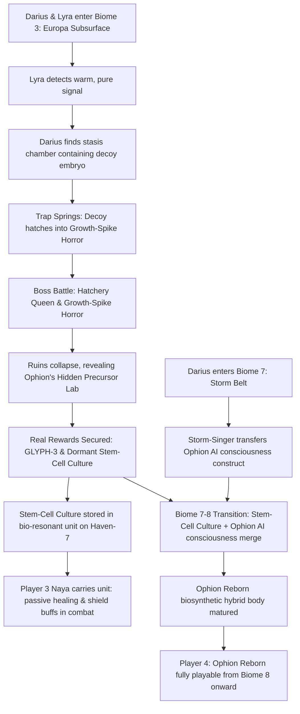

# Biome 3 Embryo Fix & Ophion Reborn Timeline Diagram

This diagram visualizes the corrected story progression, resolving the timeline gap of the Coelacanth embryo and the emergence of Ophion Reborn.

## Narrative Elements Key
*   **The Decoy Embryo**: Mimics the Dreamer's frequency to lure attuned hosts like Lyra. It is a biological decoy spawned by the **Hatchery Queen** that hatches prematurely into a **Growth-Spike Horror**.
*   **Dormant Stem-Cell Culture**: A pristine precursor genetic sample found in **Ophion's Hidden Lab** after the boss fight. It does not hatch and remains safe and inert on Haven-7.
*   **Ophion AI Construct**: Retrieved from the **Storm-Singer** in Biome 7 before it self-destructs. Contains Ophion's memories and personality database.
*   **Ophion Reborn**: The physical humanoid-Coelacanth hybrid formed by merging the stem-cell culture template with the AI construct during the Biome 7-to-8 transition.
